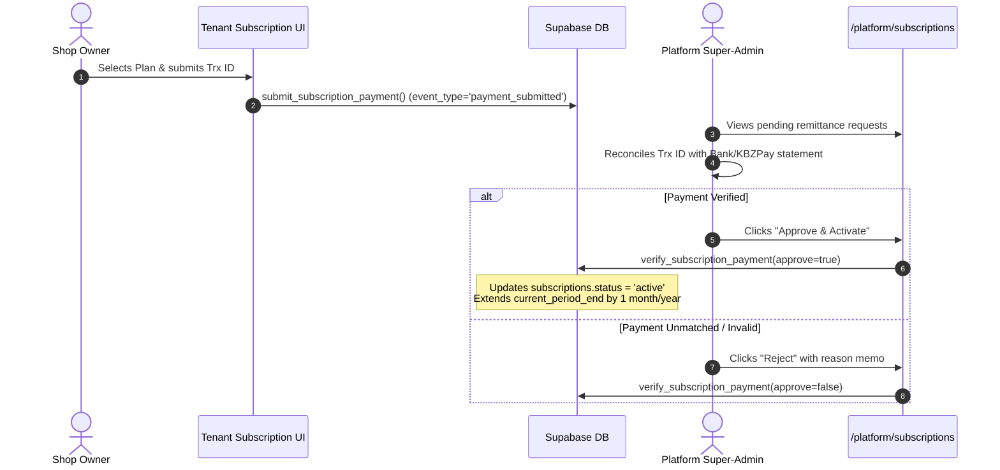

# ShopFlow — Platform Admin & Operations Guide

## 1. Overview of Platform Administration

Platform Super-Administrators have elevated access across all tenant organizations via the `/platform/*` interface. Platform privileges are granted exclusively by setting `is_platform_admin = true` on the target profile record in `public.profiles`.

---

## 2. Platform Routes & Capabilities

| Route | Functionality |
| :--- | :--- |
| `/platform/organizations` | Global directory of all tenant shops, status (Active/Suspended), active plan, and creation dates. |
| `/platform/subscriptions` | Review manual remittance slips (KBZPay, WavePay, AYA/CB transfers), approve renewals, or reject invalid claims. |
| `/platform/usage` | Inspect aggregate tenant resource consumption (product count, user limits, sales invoice volume). |
| `/platform/audit-logs` | Chronological compliance log of all critical tenant operations (sale reversals, adjustments, manual payment approvals). |

---

## 3. Manual Payment Verification Workflow

During the pilot and initial rollout, shop owners remit subscription payments via domestic mobile money (KBZPay, WavePay) or bank transfers.

---

## 4. Void & Reversal Operational Controls

1. **Anti-Hard Delete Policy:** ShopFlow prohibits hard deletion of confirmed sales or financial transactions.
2. **Reversal Audit Requirements:** Every voided invoice requires an explicit explanation reason (`void_reason`) logged in `audit_logs` along with the acting user's ID and timestamp.
3. **Inventory Rebalancing:** When a sale is reversed, compensatory positive movements (`sale_reversal`) are automatically posted to the immutable ledger to restore physical stock accuracy.

