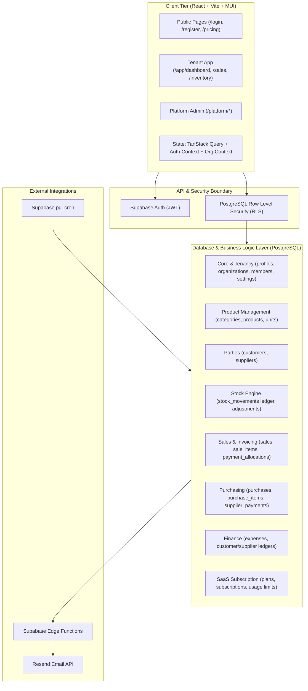

# ShopFlow — Project Architecture Document

## 1. Executive Summary

**ShopFlow** is a production-ready, multi-tenant Software-as-a-Service (SaaS) platform built for wholesale and small shop management. While initially tailored for Myanmar businesses (with native Myanmar Kyat `MMK` accounting, `Asia/Yangon` timezone conventions, bilingual and local payment workflows), its underlying foundation is internationally extensible.

The system is architected as a **modular monolith** with strict data isolation, server-side transactional guarantees, and self-service SaaS subscription lifecycles.

---

## 2. Technology Stack & Component Responsibilities

### 2.1 Frontend Architecture
- **Framework & Tooling:** React 19 / 18, Vite (fast HMR, optimized production builds), TypeScript (Strict Mode).
- **Design System & UI:** Material UI (MUI v6) with customized enterprise palette, responsive density layouts, accessible WCAG 2.1 AA components, and dark/light mode support.
- **Routing & Navigation:** React Router v7 / v6 with route-level code splitting, protected route guards, organization switcher context, and platform administration boundaries.
- **Server State & Caching:** TanStack Query (React Query v5) with optimistic updates, mutation retry logic, and strict cache invalidation keys tied to active `organization_id`.
- **Forms & Validation:** React Hook Form integrated with Zod schemas for compile-time and runtime validation.
- **HTTP Client:** Native fetch wrapper and Axios client with interceptors for auth headers, Supabase sessions, correlation request IDs, and standardized API error formatting.

### 2.2 Backend Architecture (Supabase & PostgreSQL)
- **Database Engine:** PostgreSQL 15+ hosted on Supabase.
- **Authentication:** Supabase Auth (GoTrue) handling email/password, magic links, session refreshes, and JWT tokens.
- **Multi-Tenant Security:** PostgreSQL Row Level Security (RLS) on all organization-owned tables. Zero frontend trust: RLS queries check active organization membership via `auth.uid()` and verified membership records.
- **Business Logic & Atomicity:** PostgreSQL Functions (`SECURITY DEFINER` with strict `SET search_path = public, pg_temp;`) executing atomic sales confirmations, inventory ledger posts, payment allocations, and reversal operations.
- **Asynchronous & Scheduled Tasks:**
  - Supabase Edge Functions (Deno / TypeScript) for payment webhooks, external integrations (Resend), and batch exports.
  - Supabase Cron (`pg_cron`) for subscription expiry checks, daily summary emails, and cleanup tasks.
- **Outbox Pattern:** Transactional outbox table (`audit_logs` & `notification_outbox`) ensuring at-least-once delivery of transactional emails and webhook triggers.

### 2.3 Third-Party Services
| Service | Purpose | Integration Point |
| :--- | :--- | :--- |
| **Resend** | Transactional emails (invite, invoice receipts, trial alerts) | Supabase Edge Functions & Outbox Runner |
| **Sentry** | Error monitoring & performance tracking | React frontend error boundary + Edge Functions |
| **PostHog** | Product analytics & user journey tracking | React telemetry client & feature flag evaluations |
| **Playwright** | End-to-end integration and security regression tests | CI/CD automation suite |

---

## 3. High-Level Modular Monolith Diagram



---

## 4. Multi-Tenant Security Model

### 4.1 Strict Data Isolation
1. **Organization ID Requirement:** Every single business table includes `organization_id UUID NOT NULL REFERENCES organizations(id) ON DELETE CASCADE`.
2. **PostgreSQL RLS Functions:**
   ```sql
   create or replace function public.has_org_membership(target_org_id uuid)
   returns boolean
   language sql
   stable
   security definer
   set search_path = public, pg_temp
   as $$
     select exists (
       select 1 from public.organization_members
       where organization_id = target_org_id
         and user_id = auth.uid()
         and is_active = true
     );
   $$;
   ```
3. **No Service-Role Leak:** The frontend client uses only the public anon key. All elevated actions run through `SECURITY DEFINER` RPCs that re-verify membership and permissions internally.
4. **Idempotency Keys:** Every critical financial operation (sale confirmation, payment receipt, stock adjustment) accepts a unique client-generated UUID `idempotency_key` to avoid double-posting on network retries.

### 4.2 Role-Based Access Control (RBAC)
ShopFlow supports 4 roles within an organization:

| Capability / Resource | Owner | Admin | Manager | Staff |
| :--- | :---: | :---: | :---: | :---: |
| Manage Organization Settings & Billing | ✅ | ❌ | ❌ | ❌ |
| Invite / Manage Organization Members | ✅ | ✅ | ❌ | ❌ |
| View Financial Reports & Profit Margins | ✅ | ✅ | ✅ | ❌ |
| Manage Suppliers, Purchases, Stock Costs | ✅ | ✅ | ✅ | ❌ |
| Create & Confirm Sales Orders / Invoices | ✅ | ✅ | ✅ | ✅ |
| Collect Cash/Partial Payments | ✅ | ✅ | ✅ | ✅ |
| Void / Reverse Transactions | ✅ | ✅ | ❌ | ❌ |
| View Customer Directory & Create Customers | ✅ | ✅ | ✅ | ✅ |

Platform-wide super-admins are flagged in `profiles.is_platform_admin = true` and access `/platform/*` routes using dedicated claims, distinct from tenant permissions.

---

## 5. Architectural Directory Layout

The codebase is organized as follows:

```
wholesale-erp/
├── docs/                               # Comprehensive architecture & guides
│   └── architecture/                   # ERD, workflows, migration plans, checklists
├── supabase/
│   ├── migrations/                     # Ordered SQL migrations
│   ├── functions/                      # Supabase Edge Functions (Resend, webhooks)
│   └── seed.sql                        # Default seed data (plans, units, admin)
├── src/                                # Frontend React + Vite + TypeScript application
│   ├── assets/                         # Icons, brand logos, typography
│   ├── components/                     # Reusable UI components (MUI based)
│   │   ├── common/                     # Buttons, Dialogs, Tables, StatCards
│   │   ├── forms/                      # Form inputs with HookForm + Zod bindings
│   │   └── layout/                     # AppLayout, AuthLayout, Navbar, Sidebar
│   ├── context/                        # AuthContext, OrgContext, NotificationContext
│   ├── hooks/                          # Custom utility and business logic hooks
│   ├── lib/                            # Supabase client, Axios, formatters, currency
│   ├── modules/                        # Feature-driven modular code
│   │   ├── auth/                       # Login, Register, Forgot Password
│   │   ├── dashboard/                  # KPI metrics, low-stock widgets, sales charts
│   │   ├── products/                   # Products, categories, units
│   │   ├── customers/                  # Customers, credit ledgers, statements
│   │   ├── suppliers/                  # Suppliers, payables, purchase history
│   │   ├── purchases/                  # Purchase orders, goods receipt, supplier pay
│   │   ├── sales/                      # POS/Sales register, invoices, payments
│   │   ├── inventory/                  # Stock movements, adjustments, alerts
│   │   ├── expenses/                   # Expense management & categories
│   │   ├── reports/                    # Daily/monthly sales, gross profit, ledger
│   │   ├── settings/                   # Org profile, invoice settings, members
│   │   ├── subscription/               # Plan upgrade, billing, usage metrics
│   │   └── platform/                   # Super-admin tenant manager & audits
│   ├── routes/                         # React Router configuration & guards
│   ├── types/                          # TypeScript database & domain interfaces
│   ├── App.tsx                         # Root app component & providers
│   ├── index.css                       # Global styles
│   └── main.tsx                        # Vite entry point
├── tests/
│   └── e2e/                            # Playwright end-to-end integration tests
├── vite.config.ts                      # Vite build configuration
├── tsconfig.json                       # Strict TypeScript configuration
└── package.json                        # Dependencies and scripts
```

