# Lwal Kuu — Database Entity-Relationship Diagram & Schema Specification

## 1. Relational Entity Diagram

```mermaid
erDiagram
    PROFILES ||--o{ ORGANIZATION_MEMBERS : "belongs to"
    ORGANIZATIONS ||--o{ ORGANIZATION_MEMBERS : "has"
    ORGANIZATIONS ||--|| ORGANIZATION_SETTINGS : "configures"
    ORGANIZATIONS ||--o{ AUDIT_LOGS : "records"
    ORGANIZATIONS ||--o{ PRODUCT_CATEGORIES : "owns"
    ORGANIZATIONS ||--o{ UNITS : "owns"
    ORGANIZATIONS ||--o{ PRODUCTS : "owns"
    PRODUCT_CATEGORIES ||--o{ PRODUCTS : "categorizes"
    UNITS ||--o{ PRODUCTS : "measures"
    ORGANIZATIONS ||--o{ CUSTOMERS : "owns"
    ORGANIZATIONS ||--o{ SUPPLIERS : "owns"
    ORGANIZATIONS ||--o{ PURCHASES : "orders"
    SUPPLIERS ||--o{ PURCHASES : "fulfills"
    PURCHASES ||--|{ PURCHASE_ITEMS : "contains"
    PRODUCTS ||--o{ PURCHASE_ITEMS : "bought as"
    PURCHASES ||--o{ SUPPLIER_PAYMENTS : "paid via"
    SUPPLIERS ||--o{ SUPPLIER_PAYMENTS : "receives"
    ORGANIZATIONS ||--o{ SALES : "sells"
    CUSTOMERS ||--o{ SALES : "buys"
    SALES ||--|{ SALE_ITEMS : "contains"
    PRODUCTS ||--o{ SALE_ITEMS : "sold as"
    ORGANIZATIONS ||--o{ PAYMENTS : "receives"
    CUSTOMERS ||--o{ PAYMENTS : "pays"
    PAYMENTS ||--o{ PAYMENT_ALLOCATIONS : "allocates to"
    SALES ||--o{ PAYMENT_ALLOCATIONS : "covered by"
    ORGANIZATIONS ||--o{ STOCK_MOVEMENTS : "tracks"
    PRODUCTS ||--o{ STOCK_MOVEMENTS : "moves"
    ORGANIZATIONS ||--o{ STOCK_ADJUSTMENTS : "authorizes"
    STOCK_ADJUSTMENTS ||--o{ STOCK_MOVEMENTS : "creates"
    ORGANIZATIONS ||--o{ EXPENSE_CATEGORIES : "owns"
    ORGANIZATIONS ||--o{ EXPENSES : "incurs"
    EXPENSE_CATEGORIES ||--o{ EXPENSES : "classifies"
    PLANS ||--o{ SUBSCRIPTIONS : "subscribes to"
    ORGANIZATIONS ||--|| SUBSCRIPTIONS : "maintains"
    SUBSCRIPTIONS ||--o{ SUBSCRIPTION_EVENTS : "emits"
    ORGANIZATIONS ||--o{ USAGE_LIMITS : "enforces"
```

---

## 2. Detailed Schema Definitions

### 2.1 Core & Tenancy

#### `profiles`
User metadata extending `auth.users`.
- `id`: `UUID PRIMARY KEY REFERENCES auth.users(id) ON DELETE CASCADE`
- `full_name`: `TEXT NOT NULL`
- `phone_number`: `TEXT`
- `avatar_url`: `TEXT`
- `is_platform_admin`: `BOOLEAN NOT NULL DEFAULT FALSE`
- `created_at`: `TIMESTAMPTZ NOT NULL DEFAULT NOW()`
- `updated_at`: `TIMESTAMPTZ NOT NULL DEFAULT NOW()`

#### `organizations`
Independent tenant boundary.
- `id`: `UUID PRIMARY KEY DEFAULT gen_random_uuid()`
- `name`: `TEXT NOT NULL CHECK (length(btrim(name)) between 2 and 160)`
- `slug`: `TEXT NOT NULL UNIQUE CHECK (slug ~ '^[a-z0-9-]+$')`
- `tax_id`: `TEXT`
- `is_active`: `BOOLEAN NOT NULL DEFAULT TRUE`
- `created_at`: `TIMESTAMPTZ NOT NULL DEFAULT NOW()`
- `updated_at`: `TIMESTAMPTZ NOT NULL DEFAULT NOW()`

#### `organization_members`
User membership and role assignment per organization.
- `id`: `UUID PRIMARY KEY DEFAULT gen_random_uuid()`
- `organization_id`: `UUID NOT NULL REFERENCES organizations(id) ON DELETE CASCADE`
- `user_id`: `UUID NOT NULL REFERENCES profiles(id) ON DELETE CASCADE`
- `role`: `TEXT NOT NULL CHECK (role IN ('owner', 'admin', 'manager', 'staff'))`
- `is_active`: `BOOLEAN NOT NULL DEFAULT TRUE`
- `created_at`: `TIMESTAMPTZ NOT NULL DEFAULT NOW()`
- `updated_at`: `TIMESTAMPTZ NOT NULL DEFAULT NOW()`
- *Constraints:* `UNIQUE(organization_id, user_id)`

#### `organization_settings`
Tenant-level configuration parameters.
- `organization_id`: `UUID PRIMARY KEY REFERENCES organizations(id) ON DELETE CASCADE`
- `currency_code`: `TEXT NOT NULL DEFAULT 'MMK' CHECK (currency_code ~ '^[A-Z]{3}$')`
- `currency_symbol`: `TEXT NOT NULL DEFAULT 'Ks'`
- `timezone`: `TEXT NOT NULL DEFAULT 'Asia/Yangon'`
- `phone`: `TEXT`
- `email`: `TEXT`
- `address`: `TEXT`
- `invoice_footer`: `TEXT`
- `low_stock_threshold_default`: `INTEGER NOT NULL DEFAULT 5`
- `costing_method`: `TEXT NOT NULL DEFAULT 'weighted_average' CHECK (costing_method IN ('weighted_average', 'fifo'))`
- `created_at`: `TIMESTAMPTZ NOT NULL DEFAULT NOW()`
- `updated_at`: `TIMESTAMPTZ NOT NULL DEFAULT NOW()`

#### `audit_logs`
Immutable audit trail for compliance and activity tracking.
- `id`: `UUID PRIMARY KEY DEFAULT gen_random_uuid()`
- `organization_id`: `UUID NOT NULL REFERENCES organizations(id) ON DELETE CASCADE`
- `user_id`: `UUID REFERENCES profiles(id) ON DELETE SET NULL`
- `action`: `TEXT NOT NULL` (e.g. `sale.confirm`, `sale.void`, `inventory.adjust`)
- `entity_type`: `TEXT NOT NULL`
- `entity_id`: `UUID NOT NULL`
- `payload`: `JSONB DEFAULT '{}'::jsonb`
- `ip_address`: `TEXT`
- `created_at`: `TIMESTAMPTZ NOT NULL DEFAULT NOW()`

---

### 2.2 Product Management

#### `product_categories`
Hierarchical catalog classifications.
- `id`: `UUID PRIMARY KEY DEFAULT gen_random_uuid()`
- `organization_id`: `UUID NOT NULL REFERENCES organizations(id) ON DELETE CASCADE`
- `name`: `TEXT NOT NULL CHECK (length(btrim(name)) between 1 and 100)`
- `parent_id`: `UUID REFERENCES product_categories(id) ON DELETE SET NULL`
- `is_active`: `BOOLEAN NOT NULL DEFAULT TRUE`
- `created_at`: `TIMESTAMPTZ NOT NULL DEFAULT NOW()`
- `updated_at`: `TIMESTAMPTZ NOT NULL DEFAULT NOW()`
- *Constraints:* `UNIQUE(organization_id, name)`

#### `units`
Units of measurement (e.g., pcs, box, kg, pack).
- `id`: `UUID PRIMARY KEY DEFAULT gen_random_uuid()`
- `organization_id`: `UUID NOT NULL REFERENCES organizations(id) ON DELETE CASCADE`
- `code`: `TEXT NOT NULL CHECK (length(btrim(code)) between 1 and 20)`
- `name`: `TEXT NOT NULL CHECK (length(btrim(name)) between 1 and 60)`
- `precision`: `SMALLINT NOT NULL DEFAULT 0 CHECK (precision between 0 and 4)`
- `is_active`: `BOOLEAN NOT NULL DEFAULT TRUE`
- `created_at`: `TIMESTAMPTZ NOT NULL DEFAULT NOW()`
- `updated_at`: `TIMESTAMPTZ NOT NULL DEFAULT NOW()`
- *Constraints:* `UNIQUE(organization_id, code)`

#### `products`
Item catalog master table with pricing and costing metadata.
- `id`: `UUID PRIMARY KEY DEFAULT gen_random_uuid()`
- `organization_id`: `UUID NOT NULL REFERENCES organizations(id) ON DELETE CASCADE`
- `sku`: `TEXT NOT NULL CHECK (length(btrim(sku)) between 1 and 64)`
- `barcode`: `TEXT`
- `name`: `TEXT NOT NULL CHECK (length(btrim(name)) between 1 and 200)`
- `description`: `TEXT`
- `category_id`: `UUID REFERENCES product_categories(id) ON DELETE SET NULL`
- `unit_id`: `UUID NOT NULL REFERENCES units(id) ON DELETE RESTRICT`
- `purchase_price`: `NUMERIC(14, 2) NOT NULL DEFAULT 0.00 CHECK (purchase_price >= 0)`
- `sale_price`: `NUMERIC(14, 2) NOT NULL DEFAULT 0.00 CHECK (sale_price >= 0)`
- `average_cost`: `NUMERIC(14, 4) NOT NULL DEFAULT 0.0000 CHECK (average_cost >= 0)`
- `low_stock_threshold`: `NUMERIC(12, 2) NOT NULL DEFAULT 5.00 CHECK (low_stock_threshold >= 0)`
- `is_active`: `BOOLEAN NOT NULL DEFAULT TRUE`
- `created_at`: `TIMESTAMPTZ NOT NULL DEFAULT NOW()`
- `updated_at`: `TIMESTAMPTZ NOT NULL DEFAULT NOW()`
- *Constraints:* `UNIQUE(organization_id, sku)`

---

### 2.3 Customers & Suppliers

#### `customers`
Customer entity managing credit terms, balances, and contact info.
- `id`: `UUID PRIMARY KEY DEFAULT gen_random_uuid()`
- `organization_id`: `UUID NOT NULL REFERENCES organizations(id) ON DELETE CASCADE`
- `name`: `TEXT NOT NULL CHECK (length(btrim(name)) between 1 and 200)`
- `phone`: `TEXT`
- `email`: `TEXT`
- `address`: `TEXT`
- `credit_limit`: `NUMERIC(14, 2) NOT NULL DEFAULT 0.00 CHECK (credit_limit >= 0)`
- `opening_balance`: `NUMERIC(14, 2) NOT NULL DEFAULT 0.00`
- `is_active`: `BOOLEAN NOT NULL DEFAULT TRUE`
- `created_at`: `TIMESTAMPTZ NOT NULL DEFAULT NOW()`
- `updated_at`: `TIMESTAMPTZ NOT NULL DEFAULT NOW()`

#### `suppliers`
Supplier directory for purchasing and accounts payable.
- `id`: `UUID PRIMARY KEY DEFAULT gen_random_uuid()`
- `organization_id`: `UUID NOT NULL REFERENCES organizations(id) ON DELETE CASCADE`
- `name`: `TEXT NOT NULL CHECK (length(btrim(name)) between 1 and 200)`
- `contact_person`: `TEXT`
- `phone`: `TEXT`
- `email`: `TEXT`
- `address`: `TEXT`
- `opening_balance`: `NUMERIC(14, 2) NOT NULL DEFAULT 0.00`
- `is_active`: `BOOLEAN NOT NULL DEFAULT TRUE`
- `created_at`: `TIMESTAMPTZ NOT NULL DEFAULT NOW()`
- `updated_at`: `TIMESTAMPTZ NOT NULL DEFAULT NOW()`

---

### 2.4 Purchasing & Accounts Payable

#### `purchases`
Purchase orders and supplier bills.
- `id`: `UUID PRIMARY KEY DEFAULT gen_random_uuid()`
- `organization_id`: `UUID NOT NULL REFERENCES organizations(id) ON DELETE CASCADE`
- `supplier_id`: `UUID NOT NULL REFERENCES suppliers(id) ON DELETE RESTRICT`
- `purchase_number`: `TEXT NOT NULL`
- `purchase_date`: `DATE NOT NULL DEFAULT CURRENT_DATE`
- `status`: `TEXT NOT NULL DEFAULT 'draft' CHECK (status IN ('draft', 'ordered', 'received', 'voided'))`
- `subtotal`: `NUMERIC(14, 2) NOT NULL DEFAULT 0.00 CHECK (subtotal >= 0)`
- `tax_amount`: `NUMERIC(14, 2) NOT NULL DEFAULT 0.00 CHECK (tax_amount >= 0)`
- `discount_amount`: `NUMERIC(14, 2) NOT NULL DEFAULT 0.00 CHECK (discount_amount >= 0)`
- `total_amount`: `NUMERIC(14, 2) NOT NULL DEFAULT 0.00 CHECK (total_amount >= 0)`
- `paid_amount`: `NUMERIC(14, 2) NOT NULL DEFAULT 0.00 CHECK (paid_amount >= 0)`
- `notes`: `TEXT`
- `created_by`: `UUID REFERENCES profiles(id) ON DELETE SET NULL`
- `created_at`: `TIMESTAMPTZ NOT NULL DEFAULT NOW()`
- `updated_at`: `TIMESTAMPTZ NOT NULL DEFAULT NOW()`
- *Constraints:* `UNIQUE(organization_id, purchase_number)`

#### `purchase_items`
Line items for purchase orders.
- `id`: `UUID PRIMARY KEY DEFAULT gen_random_uuid()`
- `organization_id`: `UUID NOT NULL REFERENCES organizations(id) ON DELETE CASCADE`
- `purchase_id`: `UUID NOT NULL REFERENCES purchases(id) ON DELETE CASCADE`
- `product_id`: `UUID NOT NULL REFERENCES products(id) ON DELETE RESTRICT`
- `quantity`: `NUMERIC(12, 2) NOT NULL CHECK (quantity > 0)`
- `unit_cost`: `NUMERIC(14, 2) NOT NULL CHECK (unit_cost >= 0)`
- `total_cost`: `NUMERIC(14, 2) NOT NULL CHECK (total_cost >= 0)`
- `received_quantity`: `NUMERIC(12, 2) NOT NULL DEFAULT 0.00 CHECK (received_quantity >= 0)`
- `created_at`: `TIMESTAMPTZ NOT NULL DEFAULT NOW()`

#### `supplier_payments`
Disbursements made to suppliers against purchases.
- `id`: `UUID PRIMARY KEY DEFAULT gen_random_uuid()`
- `organization_id`: `UUID NOT NULL REFERENCES organizations(id) ON DELETE CASCADE`
- `supplier_id`: `UUID NOT NULL REFERENCES suppliers(id) ON DELETE RESTRICT`
- `purchase_id`: `UUID REFERENCES purchases(id) ON DELETE SET NULL`
- `payment_number`: `TEXT NOT NULL`
- `payment_date`: `DATE NOT NULL DEFAULT CURRENT_DATE`
- `amount`: `NUMERIC(14, 2) NOT NULL CHECK (amount > 0)`
- `payment_method`: `TEXT NOT NULL CHECK (payment_method IN ('cash', 'bank_transfer', 'mobile_money', 'kbz_pay', 'wave_pay', 'other'))`
- `reference_number`: `TEXT`
- `notes`: `TEXT`
- `created_by`: `UUID REFERENCES profiles(id) ON DELETE SET NULL`
- `created_at`: `TIMESTAMPTZ NOT NULL DEFAULT NOW()`
- *Constraints:* `UNIQUE(organization_id, payment_number)`

---

### 2.5 Sales & Accounts Receivable

#### `sales`
Customer invoices and POS transactions.
- `id`: `UUID PRIMARY KEY DEFAULT gen_random_uuid()`
- `organization_id`: `UUID NOT NULL REFERENCES organizations(id) ON DELETE CASCADE`
- `customer_id`: `UUID REFERENCES customers(id) ON DELETE RESTRICT`
- `invoice_number`: `TEXT NOT NULL`
- `sale_date`: `DATE NOT NULL DEFAULT CURRENT_DATE`
- `status`: `TEXT NOT NULL DEFAULT 'draft' CHECK (status IN ('draft', 'confirmed', 'voided', 'reversed'))`
- `subtotal`: `NUMERIC(14, 2) NOT NULL DEFAULT 0.00 CHECK (subtotal >= 0)`
- `discount_amount`: `NUMERIC(14, 2) NOT NULL DEFAULT 0.00 CHECK (discount_amount >= 0)`
- `tax_amount`: `NUMERIC(14, 2) NOT NULL DEFAULT 0.00 CHECK (tax_amount >= 0)`
- `total_amount`: `NUMERIC(14, 2) NOT NULL DEFAULT 0.00 CHECK (total_amount >= 0)`
- `total_cost`: `NUMERIC(14, 2) NOT NULL DEFAULT 0.00 CHECK (total_cost >= 0)` (recorded at confirmation for gross profit)
- `paid_amount`: `NUMERIC(14, 2) NOT NULL DEFAULT 0.00 CHECK (paid_amount >= 0)`
- `payment_status`: `TEXT NOT NULL DEFAULT 'unpaid' CHECK (payment_status IN ('unpaid', 'partial', 'paid'))`
- `due_date`: `DATE`
- `notes`: `TEXT`
- `idempotency_key`: `TEXT UNIQUE`
- `voided_at`: `TIMESTAMPTZ`
- `void_reason`: `TEXT`
- `created_by`: `UUID REFERENCES profiles(id) ON DELETE SET NULL`
- `created_at`: `TIMESTAMPTZ NOT NULL DEFAULT NOW()`
- `updated_at`: `TIMESTAMPTZ NOT NULL DEFAULT NOW()`
- *Constraints:* `UNIQUE(organization_id, invoice_number)`

#### `sale_items`
Line items for sales invoices.
- `id`: `UUID PRIMARY KEY DEFAULT gen_random_uuid()`
- `organization_id`: `UUID NOT NULL REFERENCES organizations(id) ON DELETE CASCADE`
- `sale_id`: `UUID NOT NULL REFERENCES sales(id) ON DELETE CASCADE`
- `product_id`: `UUID NOT NULL REFERENCES products(id) ON DELETE RESTRICT`
- `quantity`: `NUMERIC(12, 2) NOT NULL CHECK (quantity > 0)`
- `unit_price`: `NUMERIC(14, 2) NOT NULL CHECK (unit_price >= 0)`
- `unit_cost`: `NUMERIC(14, 4) NOT NULL DEFAULT 0.0000` (snapshot of average cost at sale time)
- `discount_amount`: `NUMERIC(14, 2) NOT NULL DEFAULT 0.00 CHECK (discount_amount >= 0)`
- `total_amount`: `NUMERIC(14, 2) NOT NULL CHECK (total_amount >= 0)`
- `created_at`: `TIMESTAMPTZ NOT NULL DEFAULT NOW()`

#### `payments`
Receipts collected from customers.
- `id`: `UUID PRIMARY KEY DEFAULT gen_random_uuid()`
- `organization_id`: `UUID NOT NULL REFERENCES organizations(id) ON DELETE CASCADE`
- `customer_id`: `UUID NOT NULL REFERENCES customers(id) ON DELETE RESTRICT`
- `payment_number`: `TEXT NOT NULL`
- `payment_date`: `DATE NOT NULL DEFAULT CURRENT_DATE`
- `amount`: `NUMERIC(14, 2) NOT NULL CHECK (amount > 0)`
- `allocated_amount`: `NUMERIC(14, 2) NOT NULL DEFAULT 0.00 CHECK (allocated_amount >= 0)`
- `payment_method`: `TEXT NOT NULL CHECK (payment_method IN ('cash', 'bank_transfer', 'mobile_money', 'kbz_pay', 'wave_pay', 'other'))`
- `reference_number`: `TEXT`
- `notes`: `TEXT`
- `status`: `TEXT NOT NULL DEFAULT 'posted' CHECK (status IN ('posted', 'voided'))`
- `idempotency_key`: `TEXT UNIQUE`
- `created_by`: `UUID REFERENCES profiles(id) ON DELETE SET NULL`
- `created_at`: `TIMESTAMPTZ NOT NULL DEFAULT NOW()`
- *Constraints:* `UNIQUE(organization_id, payment_number)`

#### `payment_allocations`
Maps payment receipts directly to specific sales invoices.
- `id`: `UUID PRIMARY KEY DEFAULT gen_random_uuid()`
- `organization_id`: `UUID NOT NULL REFERENCES organizations(id) ON DELETE CASCADE`
- `payment_id`: `UUID NOT NULL REFERENCES payments(id) ON DELETE CASCADE`
- `sale_id`: `UUID NOT NULL REFERENCES sales(id) ON DELETE CASCADE`
- `allocated_amount`: `NUMERIC(14, 2) NOT NULL CHECK (allocated_amount > 0)`
- `created_at`: `TIMESTAMPTZ NOT NULL DEFAULT NOW()`
- *Constraints:* `UNIQUE(payment_id, sale_id)`

---

### 2.6 Inventory & Stock Ledger

#### `stock_movements`
The **immutable source of truth** for all inventory changes.
- `id`: `UUID PRIMARY KEY DEFAULT gen_random_uuid()`
- `organization_id`: `UUID NOT NULL REFERENCES organizations(id) ON DELETE CASCADE`
- `product_id`: `UUID NOT NULL REFERENCES products(id) ON DELETE RESTRICT`
- `movement_type`: `TEXT NOT NULL CHECK (movement_type IN ('opening', 'purchase_in', 'sales_out', 'customer_return', 'supplier_return', 'adjustment_in', 'adjustment_out', 'sale_reversal'))`
- `quantity`: `NUMERIC(12, 2) NOT NULL` (positive for inflows, negative for outflows)
- `unit_cost`: `NUMERIC(14, 4) NOT NULL DEFAULT 0.0000`
- `reference_type`: `TEXT NOT NULL CHECK (reference_type IN ('purchase', 'sale', 'adjustment', 'opening'))`
- `reference_id`: `UUID NOT NULL`
- `notes`: `TEXT`
- `created_by`: `UUID REFERENCES profiles(id) ON DELETE SET NULL`
- `created_at`: `TIMESTAMPTZ NOT NULL DEFAULT NOW()`

#### `stock_adjustments`
Administrative stock corrections (damaged items, inventory counts).
- `id`: `UUID PRIMARY KEY DEFAULT gen_random_uuid()`
- `organization_id`: `UUID NOT NULL REFERENCES organizations(id) ON DELETE CASCADE`
- `adjustment_number`: `TEXT NOT NULL`
- `adjustment_date`: `DATE NOT NULL DEFAULT CURRENT_DATE`
- `product_id`: `UUID NOT NULL REFERENCES products(id) ON DELETE RESTRICT`
- `reason`: `TEXT NOT NULL` (e.g. `damaged`, `expired`, `count_correction`, `loss`)
- `quantity_delta`: `NUMERIC(12, 2) NOT NULL` (e.g. -2.00 or +5.00)
- `unit_cost`: `NUMERIC(14, 4) NOT NULL DEFAULT 0.0000`
- `created_by`: `UUID REFERENCES profiles(id) ON DELETE SET NULL`
- `created_at`: `TIMESTAMPTZ NOT NULL DEFAULT NOW()`
- *Constraints:* `UNIQUE(organization_id, adjustment_number)`

---

### 2.7 Finance & Expenses

#### `expense_categories`
- `id`: `UUID PRIMARY KEY DEFAULT gen_random_uuid()`
- `organization_id`: `UUID NOT NULL REFERENCES organizations(id) ON DELETE CASCADE`
- `name`: `TEXT NOT NULL`
- `is_active`: `BOOLEAN NOT NULL DEFAULT TRUE`
- `created_at`: `TIMESTAMPTZ NOT NULL DEFAULT NOW()`
- *Constraints:* `UNIQUE(organization_id, name)`

#### `expenses`
Operational expenses (utilities, rent, salaries, packaging).
- `id`: `UUID PRIMARY KEY DEFAULT gen_random_uuid()`
- `organization_id`: `UUID NOT NULL REFERENCES organizations(id) ON DELETE CASCADE`
- `category_id`: `UUID NOT NULL REFERENCES expense_categories(id) ON DELETE RESTRICT`
- `expense_date`: `DATE NOT NULL DEFAULT CURRENT_DATE`
- `amount`: `NUMERIC(14, 2) NOT NULL CHECK (amount > 0)`
- `payment_method`: `TEXT NOT NULL CHECK (payment_method IN ('cash', 'bank_transfer', 'mobile_money', 'kbz_pay', 'wave_pay', 'other'))`
- `title`: `TEXT NOT NULL`
- `notes`: `TEXT`
- `receipt_url`: `TEXT`
- `created_by`: `UUID REFERENCES profiles(id) ON DELETE SET NULL`
- `created_at`: `TIMESTAMPTZ NOT NULL DEFAULT NOW()`

---

### 2.8 SaaS Subscriptions & Usage Limits

#### `plans`
SaaS product tiers.
- `id`: `TEXT PRIMARY KEY` (e.g. `starter`, `business`, `pro`)
- `name`: `TEXT NOT NULL`
- `monthly_price_mmk`: `NUMERIC(12, 2) NOT NULL`
- `yearly_price_mmk`: `NUMERIC(12, 2) NOT NULL`
- `trial_days`: `INTEGER NOT NULL DEFAULT 14`
- `max_users`: `INTEGER NOT NULL DEFAULT 2`
- `max_products`: `INTEGER NOT NULL DEFAULT 100`
- `max_monthly_sales`: `INTEGER NOT NULL DEFAULT 200`
- `features`: `JSONB NOT NULL DEFAULT '{}'::jsonb`
- `is_active`: `BOOLEAN NOT NULL DEFAULT TRUE`

#### `subscriptions`
Organization subscription state.
- `id`: `UUID PRIMARY KEY DEFAULT gen_random_uuid()`
- `organization_id`: `UUID NOT NULL UNIQUE REFERENCES organizations(id) ON DELETE CASCADE`
- `plan_id`: `TEXT NOT NULL REFERENCES plans(id) ON DELETE RESTRICT`
- `status`: `TEXT NOT NULL CHECK (status IN ('trialing', 'active', 'past_due', 'expired', 'canceled'))`
- `billing_cycle`: `TEXT NOT NULL DEFAULT 'monthly' CHECK (billing_cycle IN ('monthly', 'yearly'))`
- `current_period_start`: `TIMESTAMPTZ NOT NULL`
- `current_period_end`: `TIMESTAMPTZ NOT NULL`
- `trial_ends_at`: `TIMESTAMPTZ`
- `cancel_at_period_end`: `BOOLEAN NOT NULL DEFAULT FALSE`
- `created_at`: `TIMESTAMPTZ NOT NULL DEFAULT NOW()`
- `updated_at`: `TIMESTAMPTZ NOT NULL DEFAULT NOW()`

#### `subscription_events`
Audit trail of subscription transitions (renewals, downgrades, manual verifications).
- `id`: `UUID PRIMARY KEY DEFAULT gen_random_uuid()`
- `subscription_id`: `UUID NOT NULL REFERENCES subscriptions(id) ON DELETE CASCADE`
- `organization_id`: `UUID NOT NULL REFERENCES organizations(id) ON DELETE CASCADE`
- `event_type`: `TEXT NOT NULL` (e.g. `trial_started`, `payment_submitted`, `payment_approved`, `expired`)
- `amount`: `NUMERIC(12, 2)`
- `payment_method`: `TEXT`
- `payment_reference`: `TEXT`
- `admin_notes`: `TEXT`
- `created_at`: `TIMESTAMPTZ NOT NULL DEFAULT NOW()`

#### `usage_limits`
Real-time usage meters cached per organization and month.
- `id`: `UUID PRIMARY KEY DEFAULT gen_random_uuid()`
- `organization_id`: `UUID NOT NULL REFERENCES organizations(id) ON DELETE CASCADE`
- `metric`: `TEXT NOT NULL CHECK (metric IN ('user_count', 'product_count', 'monthly_sales_count'))`
- `period_key`: `TEXT NOT NULL` (e.g. `2026-11` or `lifetime`)
- `current_value`: `INTEGER NOT NULL DEFAULT 0 CHECK (current_value >= 0)`
- `limit_value`: `INTEGER NOT NULL`
- `updated_at`: `TIMESTAMPTZ NOT NULL DEFAULT NOW()`
- *Constraints:* `UNIQUE(organization_id, metric, period_key)`

