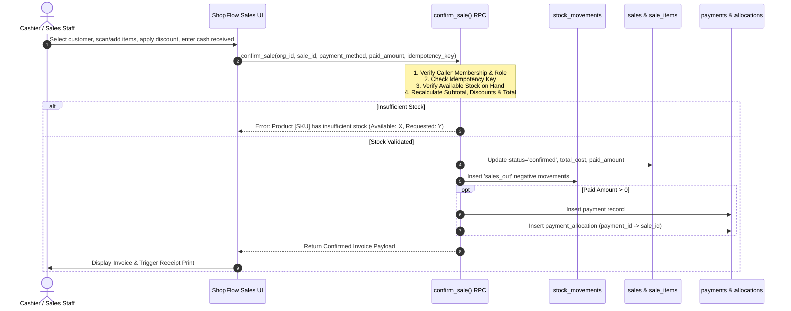
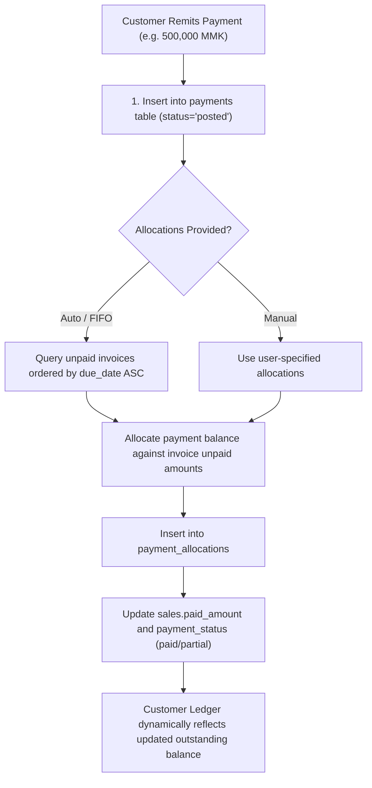

# ShopFlow — Business Workflow Documentation

## 1. Confirm Sale Workflow

The **Confirm Sale** workflow transitions a draft order into a legally binding invoice, decrements inventory via the immutable ledger, and records any collected upfront payment.

### Key Guarantees:
- **Server-Side Totals:** The frontend submits line item quantities and agreed prices; the RPC recalculates subtotal, discounts, and final total to prevent client-side tampering.
- **Cost Snapshot:** The current `average_cost` of each product is frozen into `sale_items.unit_cost`, guaranteeing historical gross profit integrity regardless of future supplier price fluctuations.
- **Zero-Sum Ledger:** Inventory decreases only through `stock_movements`, ensuring physical stock matches the ledger sum at all times.

---

## 2. Receive Purchase & Weighted Average Costing

When a wholesale shipment arrives from a supplier:
1. **Quantity Verification:** Staff inputs received item quantities and negotiated invoice costs.
2. **Weighted Average Cost Calculation:**
   $$\text{New Average Cost} = \frac{(\text{Current Qty} \times \text{Current Avg Cost}) + (\text{Received Qty} \times \text{New Unit Cost})}{\text{Current Qty} + \text{Received Qty}}$$
   *Edge Case:* If `Current Qty <= 0`, `New Average Cost` is directly set to `New Unit Cost`.
3. **Stock Increase:** Inserts positive rows (`purchase_in`) into `stock_movements`.
4. **Accounts Payable:** Increments total payable to supplier. If payment was made on delivery (e.g. cash on delivery), records a `supplier_payments` row.

---

## 3. Customer Ledger & Payment Allocation

In wholesale businesses, customers frequently purchase on credit and remit lump-sum payments covering multiple historical invoices.

### Ledger Immutability:
- Customer balance is **never stored as a raw mutable number** that can drift.
- Outstanding balance is computed as:
  $$\text{Balance} = \text{Opening Balance} + \sum \text{Confirmed Sales} - \sum \text{Allocated Payments} - \sum \text{Credit Notes}$$
- A customer statement can be generated for any date range with continuous running balances.

---

## 4. Void & Reversal Policy

Confirmed transactions cannot be deleted (`DELETE` statements are blocked by RLS and database triggers).

### Sales Reversal:
1. Status is changed from `'confirmed'` to `'reversed'`.
2. A compensating positive stock movement (`'sale_reversal'`) is inserted into `stock_movements`.
3. Any payments allocated to the sale are unallocated and credited to the customer's account.
4. An immutable audit record is logged with the user ID, timestamp, and explanation.

---

## 5. Multi-Tenant Self-Service Onboarding & SaaS Lifecycle

1. **User Sign Up:** User registers with email & password via Supabase Auth.
2. **Organization Creation:** The user submits their business name, timezone (`Asia/Yangon`), and currency (`MMK`).
3. **Trial Provisioning:** System automatically creates an entry in `subscriptions`:
   - `plan_id = 'starter'`
   - `status = 'trialing'`
   - `trial_ends_at = NOW() + INTERVAL '14 days'`
   - Baseline usage limits initialized in `usage_limits`.
4. **Usage Limit Guards:**
   - Every sale creation checks: `current monthly sales < plan limit`.
   - Every product creation checks: `current products < plan limit`.
5. **Subscription Payment (Provider Abstraction):**
   - Customer chooses plan (Starter, Business, Pro) and billing cycle (Monthly, Yearly).
   - Customer submits payment slip / transaction reference (KBZPay, WavePay, AYA, CB Bank transfer).
   - Subscription enters `past_due` or pending review.
   - Platform admin verifies transaction via `/platform/subscriptions` and activates subscription with updated `current_period_end`.
   - Extensible interface designed to plug in automated payment gateways (e.g., 2C2P, KBZPay API) once merchant credentials are confirmed.

